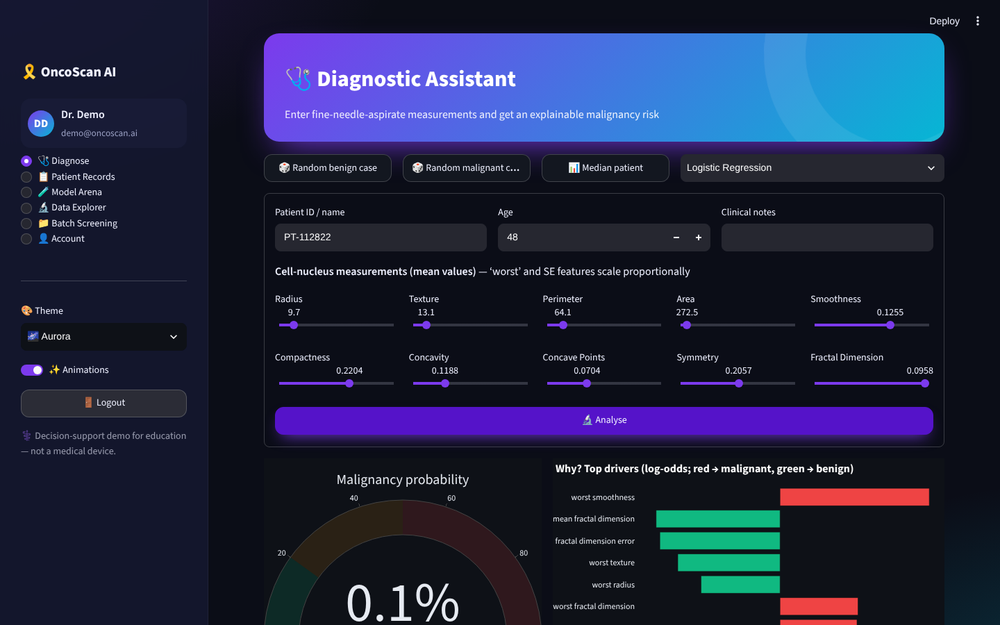
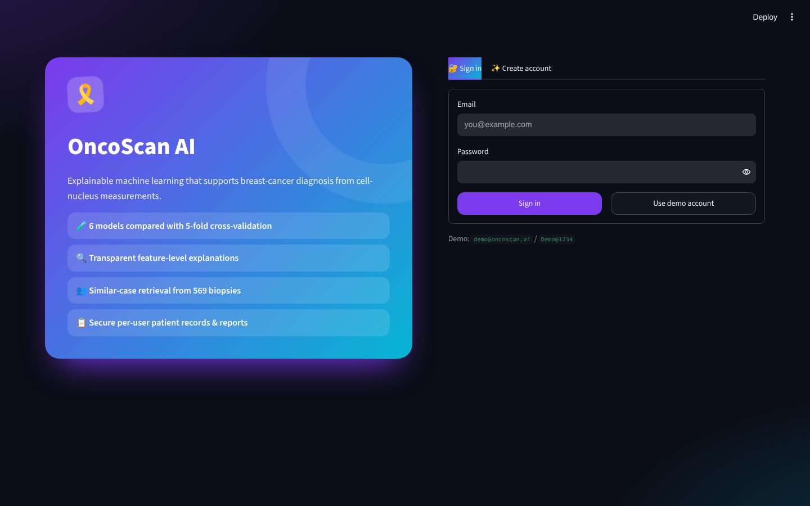
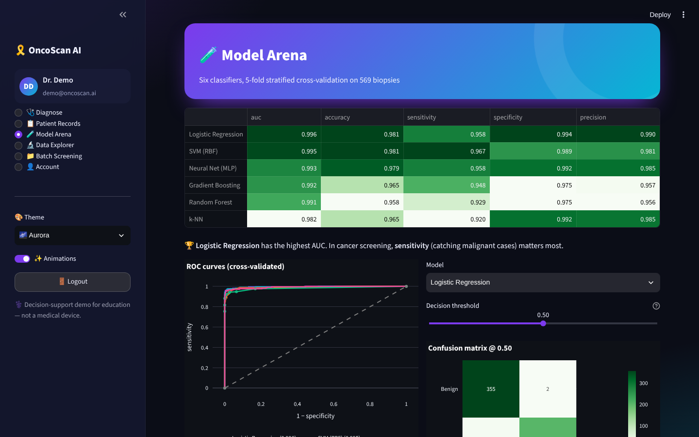
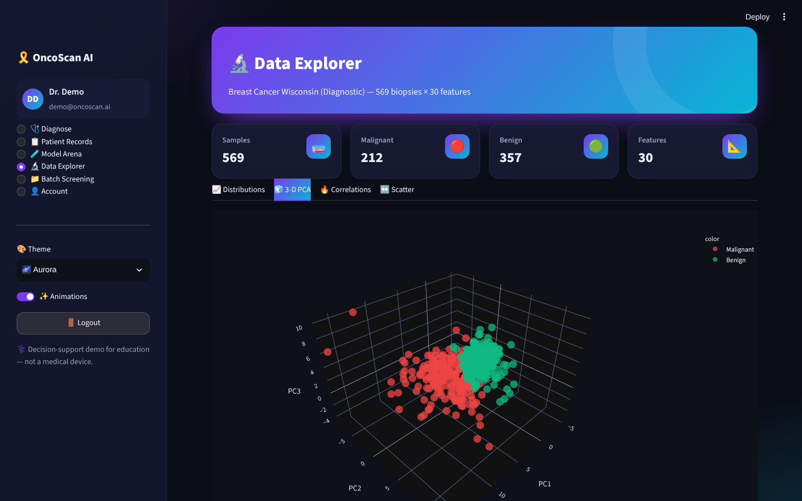
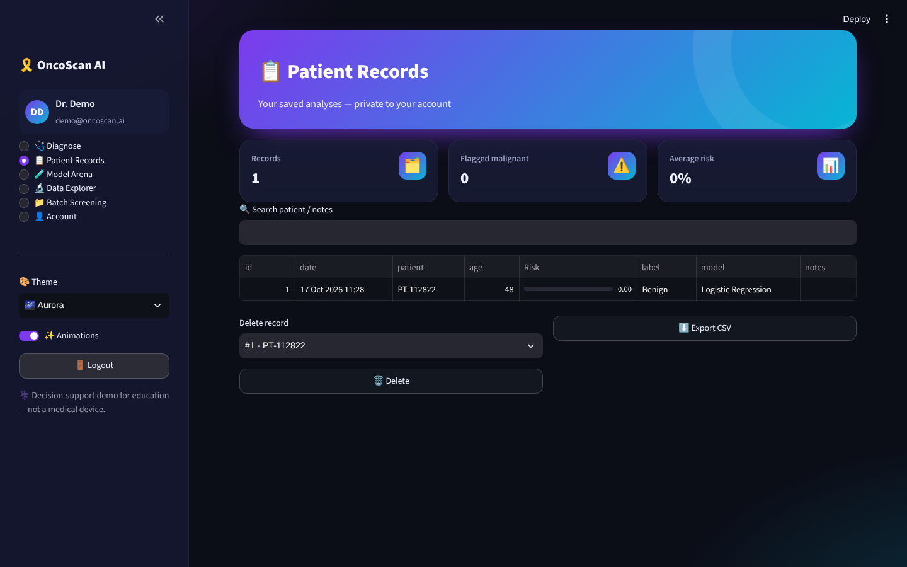
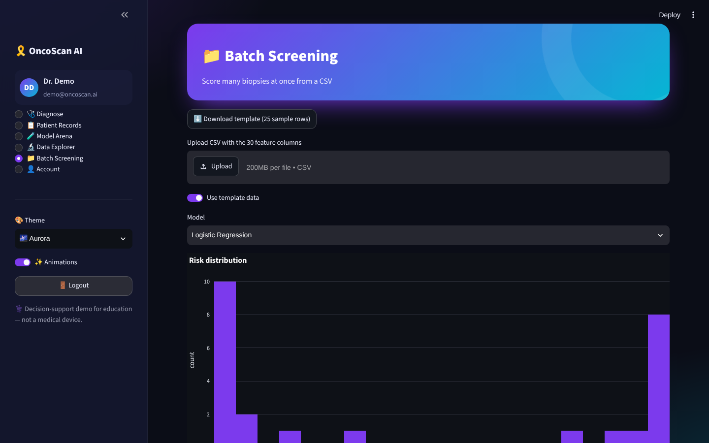

<div align="center">

# 🎗️ OncoScan AI

### Explainable machine learning for breast-cancer diagnosis support — model arena, feature-level explanations, similar-case retrieval & patient records


</div>



## ✨ Features

| Module | Highlights |
|---|---|
| 🔐 **Register / Login** | SQLite users, salted **PBKDF2-SHA256** hashing, strength meter, validation, demo account, activity log, change password |
| 🩺 **Diagnose** | Load a random benign/malignant/median case, adjust 10 cell-nucleus measurements with sliders, choose any of 6 models → animated malignancy gauge, risk band, **log-odds explanation chart**, **5 most similar historical biopsies**, downloadable report, save to records |
| 📋 **Patient Records** | Per-user saved analyses (SQLite) with search, KPIs, delete and CSV export |
| 🧪 **Model Arena** | Logistic Regression, SVM, Random Forest, Gradient Boosting, k-NN and MLP evaluated with **5-fold stratified CV** — AUC, accuracy, sensitivity, specificity, precision, ROC curves, **threshold tuning** with live confusion matrix and missed-cancer count, feature importance |
| 🔬 **Data Explorer** | Distributions by diagnosis with box plots, interactive **3-D PCA**, correlation heatmap, custom scatter plots |
| 📁 **Batch Screening** | CSV template download, upload & score many biopsies, risk histogram, export |
| 🎨 **Themes & animations** | 5 colour themes, glassmorphism cards, animated hero, page transitions, toast notifications, animation toggle |

## 🧠 Data & models

* **Breast Cancer Wisconsin (Diagnostic)** dataset — 569 fine-needle-aspirate samples, 30 features (mean, standard error and worst values of radius, texture, perimeter, area, smoothness, compactness, concavity, concave points, symmetry, fractal dimension). Ships with scikit-learn, so no download is needed.
* Cross-validated AUC ≈ 0.99 for the best models; sensitivity is highlighted because missing a malignant case is the costliest error.
* Explanations use a standardized logistic regression, where each feature’s contribution to the log-odds is exact and transparent.

## 🖼️ Screenshots

| Login | Model arena | Data explorer |
|---|---|---|
|  |  |  |

| Patient records | Batch screening |
|---|---|
|  |  |

## 🚀 Run locally

```bash
git clone https://github.com/PreciousBharath/ONCOSCAN-AI-CANCER-DIAGNOSIS.git
cd ONCOSCAN-AI-CANCER-DIAGNOSIS
pip install -r requirements.txt
streamlit run app.py
```

Click **Use demo account** (`demo@oncoscan.ai` / `Demo@1234`) or create an account.

## 🧱 Project structure

```
├── app.py              # Streamlit pages
├── core/
│   ├── engine.py       # data, model arena, explanations, similar cases, patient records
│   ├── auth.py         # SQLite users, PBKDF2 hashing, login/register UI
│   └── ui.py           # themes, animations, KPI cards, Plotly template
├── .streamlit/config.toml
└── requirements.txt
```

> ⚕️ Educational decision-support demo — not a medical device and not a substitute for clinical diagnosis.

## 📄 License

MIT © [Bharath](https://github.com/PreciousBharath)
